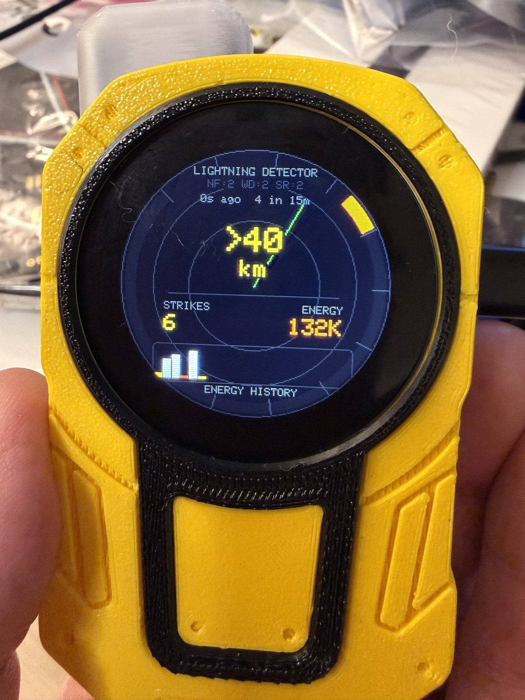

# Flash Bee

**A pocket lightning detector that tells you how far away a storm is, whether it is coming toward you, and when it is safe to go back outside. No phone signal or internet needed.**

Flash Bee was designed by **gokux** and published on Instructables: [Flash Bee: Handheld Lightning Sensing and Ranging Device](https://www.instructables.com/Flash-Bee-Handheld-Lighting-Sensing-and-Ranging-De/). It pairs an AS3935 lightning sensor with a Seeed XIAO ESP32-C3 and a round touchscreen, in a case that clips to a backpack.

This repo uses the same hardware and adds new firmware. The original shows a distance and a strike count. This version turns that into advice: a clear **SHELTER** warning, a **storm trend**, and a **30-minute all-clear** countdown. It also handles a noisy sensor better, lasts longer on a charge and comes with printed guides.

**Build this if you** hike, coach, run a field, golf or camp and want a dedicated lightning warning that works without a phone signal. It also suits a weather-station setup that reports to **Home Assistant**.

 

## What it does

| | gokux's original | This version |
|---|---|---|
| Strike distance (to 40 km), count and energy | ✓ | ✓ (miles or km) |
| Energy history of recent strikes | ✓ | ✓ |
| Overhead-strike warning | ✓ | ✓ |
| **SHELTER / ACTIVITY alert** | | ✓ |
| **30-minute all-clear countdown** (the 30-30 rule weather services use) | | ✓ |
| **Storm trend**: APPROACHING / MOVING AWAY / STEADY | read it yourself from the distance | ✓ automatic |
| Time since the last strike, with old readings dimmed | | ✓ |
| Swipeable pages: storm chart, flash-to-bang timer, records, settings, stats | | ✓ |
| All-time records (closest, strongest, biggest storm), kept when switched off | | ✓ |
| Demo mode | rebuild the firmware | ✓ hold the screen 3 s |
| Battery percentage, screen-off timer, brightness | | ✓ |
| Battery life (400 mAh) | 6-7 h (gokux's figure) | about 10 h with WiFi on (one measured night); longer with WiFi off, not measured yet |
| WiFi, over-the-air updates, MQTT, Home Assistant | | ✓ optional, off by default |
| Illustrated user guide, quick start and build guide (PDF) | the instructable | ✓ |

## New features in more detail

**Safety alerts**
- **SHELTER** is a large flashing banner when a strike was 10 miles (16 km) or closer in the last 30 minutes, or 5 or more strikes in the last 15. **ACTIVITY** is a quiet label for any lightning in the last 15 minutes. Neither can be dismissed: only time clears them.
- **All clear**: every close strike restarts a 30:00 countdown. When it runs out, the screen shows ALL CLEAR in green.
- **Storm trend**: fits a line through the last 10 minutes of strikes, so one odd reading does not flip the answer.

**More to look at**
- **Storm chart**: every strike of the last hour by distance, and a bar of strikes per 5 minutes.
- **Flash-to-bang**: tap at the flash and again at the thunder to get your own distance, side by side with the sensor's.
- **Records** that survive power-off, and a **Nerd stats** page for the curious.

**Better sensing**
- Sets up the AS3935 the way its datasheet says: correct gain values, calibration at every boot (CAL OK / CAL FAIL), and antenna tuning to 500 kHz. Tuning needs one extra wire.
- Handles electrical noise without going deaf for minutes. It warns **ENV TOO NOISY** when the readings cannot be trusted.
- Detects a lost sensor, shows **SENSOR LOST** and reconnects on its own. It checks its own settings every minute and repairs them if the chip resets.
- Three **operating profiles**: STATION for home, PORTABLE for carrying, STORMCHASE for watching a storm yourself. AUTO picks between home and away for you.

**Battery and reliability**
- The screen switches off after a set time and the processor sleeps between checks. A strike or a touch wakes it at once.
- A watchdog restarts the device if it ever hangs. It no longer freezes while plugged into a computer.

**Connected (optional)**
- Off by default. With WiFi set up, it gets over-the-air firmware updates and MQTT. **Home Assistant** finds it automatically: strikes, distance, alert stage, all-clear countdown, battery, and a profile selector.

## What you need

- Grove Lightning Sensor (AS3935)
- [Seeed Studio XIAO ESP32-C3](https://wiki.seeedstudio.com/XIAO_ESP32C3_Getting_Started/)
- [Round Display for XIAO](https://wiki.seeedstudio.com/get_start_round_display/)
- 3.7 V LiPo (gokux uses a 902025, 400 mAh), a slide switch, M2 and M3 screws, wire
- A 3D printer for the case

The build is the "Build your own" chapter of [`Flash Bee Guide.pdf`](Flash%20Bee%20Guide.pdf): parts, printing, wiring, flashing and a first test.

## Get started

1. **Build it** following gokux's instructable or the guide. Solder one extra wire, from the sensor's IRQ pad to the XIAO's D2, to get antenna tuning.
2. **Flash it**: with [arduino-cli](https://arduino.github.io/arduino-cli/) installed, `bash flash.sh` (or `bash flash.sh c6` for a XIAO ESP32-C6) installs the board package and libraries, compiles, uploads and opens the serial monitor. Or use the Arduino IDE: see [docs/building.md](docs/building.md#flashing).
3. **Use it**: read the two-page [`Flash Bee Quick Start.pdf`](Flash%20Bee%20Quick%20Start.pdf). To see the screens without a storm, hold a finger on the screen for 3 seconds. That starts the demo.

## What has been tested

- **In use:** gokux's case, wired by soldering, running this firmware on a XIAO ESP32-C3. This includes WiFi, Home Assistant, light sleep and antenna tuning.
- **Designed, not yet built:** a solderless case (`enclosure/flashbee_case.scad`), which links the sensor through the display's microSD slot. Also a one-piece printed travel case with a magnetic clasp (`enclosure/flashbee_travel_case.scad`).

## In this repo

| Path | What it is |
|---|---|
| `FlashBee/` | Arduino firmware |
| `Flash Bee Quick Start.pdf`, `Flash Bee Guide.pdf` | Printable guides, built by `guide/make_guide.py` |
| `Flash Bee/` | gokux's case: STL, STEP and PrusaSlicer projects |
| `enclosure/` | OpenSCAD designs: the solderless case, the travel case and a concept; sliced files in `exports/` |
| `tools/provision.py` | Sets WiFi, OTA and MQTT over USB |
| [`docs/using.md`](docs/using.md) | What every screen means |
| [`docs/building.md`](docs/building.md) | Wiring, flashing, enclosures, rebuilding the guides |
| [`docs/firmware.md`](docs/firmware.md) | Full technical reference: every change from the original, sensor details, network, MQTT topics, power, test console |

## Important

This is a hobby device, not a safety device. It can miss strikes. When you hear thunder, go indoors, and stay there until 30 minutes after the last one.

## License

Flash Bee was designed by gokux and published under [Creative Commons Attribution-NonCommercial-ShareAlike 4.0](LICENSE). This project is derived from it and uses the same license. That covers the firmware, guides, enclosure designs and print files. You may use, change and share it non-commercially if you credit gokux and this project and share your changes under the same license. The build photos in the guide are gokux's.
